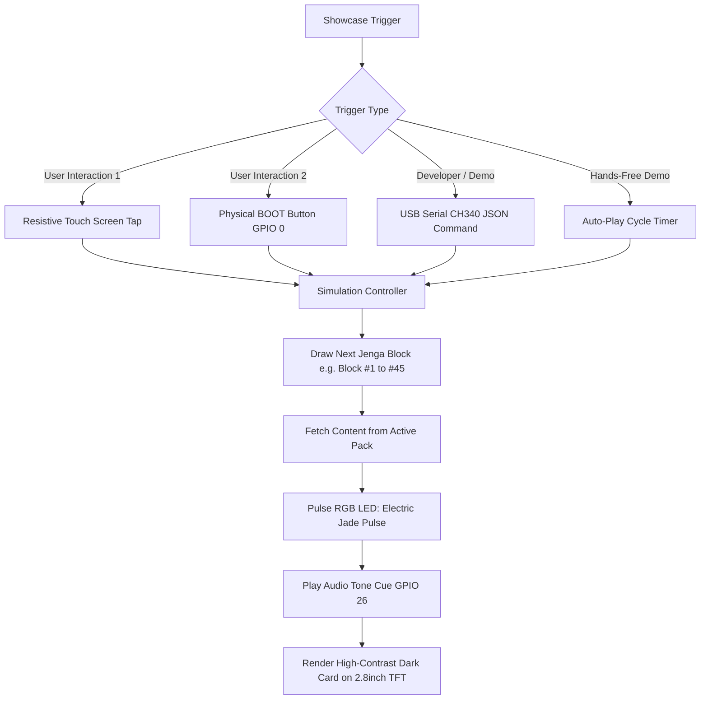

# Jeemu Hardware Showcase — ESP32-2432S028R (2.8" TFT) Implementation Plan

**Target Device:** ESP32-2432S028R ("Cheap Yellow Display" / Sunton 2.8" Resistive Touch)  
**Display:** 2.8" TFT LCD (320×240 Landscape), ILI9341 Driver + XPT2046 Touch  
**Theme:** Jeemu Forest Charcoal & Electric Jade Dark System  
**Current Phase:** Showcase Prototype (Simulated NFC / Virtual Block Tap)  
**Future Phase:** Drop-in NFC Reader (PN532 / ST25R3916 via I2C/SPI Expansion)  

---

## 1. Hardware Overview & Pinout Blueprint

The **ESP32-2432S028R** is an all-in-one board featuring an ESP32 dual-core MCU, 2.8-inch 320×240 color TFT, resistive touch panel, onboard CH340 USB-UART bridge, RGB status LED, and audio amplifier.

```
+-------------------------------------------------------------------------+
|                        ESP32-2432S028R (Top View)                       |
|                                                                         |
|  +-------------------------------------------------------------------+  |
|  |                                                                   |  |
|  |                    2.8" TFT LCD (320 x 240)                       |  |
|  |             Jeemu Dark Theme: Forest Charcoal + Jade              |  |
|  |                                                                   |  |
|  |   [ BLOCK #14 ]   Drinking Game Pack          [ 38/45 Left ]      |  |
|  |                                                                   |  |
|  |   "Take 2 sips if you have ever checked your work email           |  |
|  |    on a date, or nominate someone to take 3 sips."                |  |
|  |                                                                   |  |
|  |   [ TAP SCREEN OR PRESS BOOT BUTTON TO DRAW NEXT BLOCK ]          |  |
|  +-------------------------------------------------------------------+  |
|                                                                         |
|  [RST]   [BOOT (GPIO 0)]    (O) RGB LED (GPIO 4/16/17)    [MicroUSB/CH340]
+-------------------------------------------------------------------------+
```

### Complete GPIO Mapping Table

| Subsystem | Signal Name | ESP32 GPIO | Notes |
|---|---|---|---|
| **TFT Display (ILI9341)** | TFT_MISO | **GPIO 12** | Hardware VSPI/HSPI |
| | TFT_MOSI | **GPIO 13** | Display Data In |
| | TFT_SCLK | **GPIO 14** | Display SPI Clock |
| | TFT_CS | **GPIO 15** | Display Chip Select |
| | TFT_DC / RS | **GPIO 2** | Data / Command Select |
| | TFT_RST | **-1** | Connected to board EN / Reset |
| | TFT_BL (Backlight)| **GPIO 21** | Backlight PWM control (or digital ON) |
| **Touch (XPT2046)** | TOUCH_CLK | **GPIO 25** | Software/Hardware SPI Clock |
| | TOUCH_CS | **GPIO 33** | Touch Chip Select |
| | TOUCH_MOSI | **GPIO 32** | Touch Data In |
| | TOUCH_MISO | **GPIO 39** | Touch Data Out (Input only) |
| | TOUCH_IRQ | **GPIO 36** | Touch Interrupt (Input only) |
| **Status RGB LED** | Red LED | **GPIO 4** | Active LOW (0 = ON, 1 = OFF) |
| | Green LED | **GPIO 16** | Active LOW (Electric Jade cue) |
| | Blue LED | **GPIO 17** | Active LOW |
| **User Inputs** | BOOT Button | **GPIO 0** | Active LOW (used to simulate block tap) |
| | LDR Sensor | **GPIO 34** | Ambient light sensor (analog) |
| **Audio** | Speaker / Buzzer | **GPIO 26** | Connected to onboard PAM8302 / transistor |
| **Expansion Header (P3)**| CN1 / P3 Port | **GPIO 22, 27** | Reserved for I2C NFC Reader (SDA / SCL) |

---

## 2. PC Setup & Driver Installation

### 2.1 CH340 Driver Setup (Windows)
1. Extract the downloaded `USB-SERIAL CH340.rar` (or `CH341SER.EXE`).
2. Run `SETUP.EXE` as Administrator.
3. Click **Install**. A prompt will indicate `The drive is successfully Pre-installed in the machine!`.
4. Connect the ESP32-2432S028R to your PC via a data-capable MicroUSB cable.
5. Open **Device Manager** -> expand **Ports (COM & LPT)**:
   - You should see `USB-SERIAL CH340 (COMx)` where `x` is your port number (e.g. `COM3` or `COM5`).

---

## 3. Visual Architecture: Jeemu Dark Theme (RGB565)

The display uses 16-bit 565 color format (5 bits Red, 6 bits Green, 5 bits Blue). The colors are mapped directly from Jeemu's web design system:

| Design Token | CSS Hex | RGB888 | 16-bit RGB565 Hex | UI Usage |
|---|---|---|---|---|
| **Base Charcoal** | `#0c100e` | `(12, 16, 14)` | `0x0842` | Screen background canvas |
| **Obsidian Dark** | `#060a08` | `(6, 10, 8)` | `0x0041` | Top/Bottom status bars |
| **Surface Card** | `#111613` | `(17, 22, 19)` | `0x10C2` | Challenge card container |
| **Electric Jade** | `#00d97e` | `(0, 217, 126)` | `0x06EF` | Accent badges, borders, button cues |
| **Bone Sage** | `#e2ede5` | `(226, 237, 229)`| `0xE77C` | Main challenge body text |
| **Cool Grey-Green**| `#8ea89a` | `(142, 168, 154)`| `0x8D53` | Subtitles, block counters, hints |
| **Alert Amber** | `#f59e0b` | `(245, 158, 11)` | `0xFCE1` | Timer countdown / penalty cards |

### Screen Layout Matrix (320 × 240)

```
0,0 ------------------------------------------------------------- 320,0
|  [JEEMU]                     MODE: DRINKING PACK           41/45  |  <- Top Bar (h=28px)
|-------------------------------------------------------------------|
|  +-------------------------------------------------------------+  |
|  | [BLOCK #08]                  CATEGORY: WILD DARE            |  |  <- Card Header (h=24px)
|  |                                                             |  |
|  |   "Nominate two players to swap seats without touching       |  |  <- Challenge Body Text
|  |    the table, or everyone takes a sip."                     |  |     (h=110px, Bone Sage)
|  |                                                             |  |
|  |   Action Timer: [ 30s ]             Difficulty: ★ ★ ☆       |  |
|  +-------------------------------------------------------------+  |
|-------------------------------------------------------------------|
|  [TAP DISPLAY OR PRESS BOOT BUTTON TO SIMULATE BLOCK SCAN]        |  <- Bottom Cue (h=26px)
0,240 ----------------------------------------------------------- 320,240
```

---

## 4. "No-NFC" Showcase Simulation Architecture

To showcase how the physical device functions before receiving the NFC hardware module, the firmware implements three parallel trigger mechanisms:



1. **Touch Screen Tap (XPT2046):** Tapping anywhere on the display triggers the "block scan" transition.
2. **BOOT Button (GPIO 0):** Holding or clicking the physical button on the board simulates pulling and tapping a physical block on the box.
3. **USB-Serial Command Interface (115200 baud):**
   - Send `SCAN:14` -> Instantly reveals Block #14.
   - Send `MODE:PARTY` -> Changes the active game pack to Party/Drinking.
   - Send `MODE:ICEBREAKER` -> Changes to Icebreaker.
   - Send `RESET` -> Resets game tower to 45/45 blocks.
4. **Auto-Showcase Mode:** Cycles through a curated set of cards every 8 seconds with smooth jade animations.

---

## 5. Ready-to-Flash Implementation Guide

### 5.1 Recommended Platform: PlatformIO (or Arduino IDE)

#### Option A: PlatformIO (`platformio.ini`)
```ini
[env:esp32-2432S028R]
platform = espressif32
board = esp32dev
framework = arduino
monitor_speed = 115200
upload_speed = 921600

build_flags =
    -DUSER_SETUP_LOADED=1
    -DILI9341_DRIVER=1
    -DTFT_WIDTH=240
    -DTFT_HEIGHT=320
    -DTFT_MISO=12
    -DTFT_MOSI=13
    -DTFT_SCLK=14
    -DTFT_CS=15
    -DTFT_DC=2
    -DTFT_RST=-1
    -DTFT_BL=21
    -DTFT_BACKLIGHT_ON=HIGH
    -DLOAD_GLCD=1
    -DLOAD_FONT2=1
    -DLOAD_FONT4=1
    -DLOAD_GFXFF=1
    -DSMOOTH_FONT=1
    -DSPI_FREQUENCY=40000000
    -DSPI_READ_FREQUENCY=20000000
    -DSPI_TOUCH_FREQUENCY=2500000

lib_deps =
    bodmer/TFT_eSPI@^2.5.43
    paulstoffregen/XPT2046_Touchscreen@0.0.0-alpha+sha.26b691b2c8
    bblanchon/ArduinoJson@^7.0.4
```

#### Option B: Arduino IDE Setup
1. Install **ESP32 by Espressif Systems** via Boards Manager.
2. Select Board: **ESP32 Dev Module**.
3. Install Libraries: `TFT_eSPI`, `XPT2046_Touchscreen`.
4. In Arduino libraries folder: `libraries/TFT_eSPI/User_Setup_Select.h`:
   - Comment out `#include <User_Setup.h>`
   - Uncomment `#include <User_Setups/Setup24_Custom.h>` or set pins matching GPIO 12/13/14/15/2/21.

---

### 5.2 Complete Showcase Firmware Source Code (`main.cpp`)

```cpp
#include <Arduino.h>
#include <SPI.h>
#include <TFT_eSPI.h>
#include <XPT2046_Touchscreen.h>

// --- PIN DEFINITIONS FOR ESP32-2432S028R ---
#define XPT2046_IRQ   36
#define XPT2046_MOSI  32
#define XPT2046_MISO  39
#define XPT2046_CLK   25
#define XPT2046_CS    33

#define RGB_RED_PIN   4
#define RGB_GRN_PIN   16
#define RGB_BLU_PIN   17
#define BOOT_BTN_PIN  0
#define BUZZER_PIN    26

// --- JEEMU COLOR SYSTEM (16-bit RGB565) ---
#define COLOR_BASE_CHARCOAL  0x0842  // #0c100e (Dark forest canvas)
#define COLOR_OBSIDIAN       0x0041  // #060a08 (Status bands)
#define COLOR_CARD_SURFACE   0x10C2  // #111613 (Card body)
#define COLOR_ELECTRIC_JADE  0x06EF  // #00d97e (Brand primary)
#define COLOR_BONE_SAGE      0xE77C  // #e2ede5 (High-contrast text)
#define COLOR_COOL_GREY      0x8D53  // #8ea89a (Muted text)
#define COLOR_ALERT_AMBER    0xFCE1  // #f59e0b (Highlights)

TFT_eSPI tft = TFT_eSPI();
SPIClass touchSPI = SPIClass(VSPI);
XPT2046_Touchscreen touch(XPT2046_CS, XPT2046_IRQ);

// --- JEEMU GAME CONTENT DATA MODEL ---
struct GameCard {
    uint8_t blockId;
    const char* category;
    const char* textLine1;
    const char* textLine2;
    const char* textLine3;
    uint8_t timerSeconds;
    const char* difficulty;
};

const GameCard PRESET_DECK[] = {
    {1,  "DRINKING",     "Take 2 sips if you arrived late,", "otherwise nominate another player", "to drink 2 sips.", 0, "EASY"},
    {7,  "ICE-BREAKER",  "What is the most unusual item",    "you currently have with you?",      "Everyone gets 1 guess.", 45, "CASUAL"},
    {14, "CHALLENGE",    "Stack this block horizontally",   "on top using only your non-",       "dominant hand. 30s limit!", 30, "HARD"},
    {21, "WILD CARD",    "Choose a partner. You are now",   "block-buddies: whenever one",       "drinks, both must drink.", 0, "CHAOS"},
    {28, "DEEP DIVE",    "Confess one thing you were",       "completely wrong about this year.", "Be brutally honest.", 60, "DEEP"},
    {35, "TRIVIA",       "Name 5 countries that start with", "the letter 'M' in under 15",        "seconds or finish your cup.", 15, "FAST"},
    {42, "FINAL RISK",   "Place this block vertically on",  "the narrowest side. If it falls,",  "the game is over for you.", 20, "EXTREME"}
};

const size_t TOTAL_CARDS = sizeof(PRESET_DECK) / sizeof(PRESET_DECK[0]);
size_t currentCardIndex = 0;
uint16_t blocksRemaining = 45;
unsigned long lastTapTime = 0;
bool autoDemoMode = true;
unsigned long lastAutoCycle = 0;

void setRgbLed(bool r, bool g, bool b) {
    digitalWrite(RGB_RED_PIN, r ? LOW : HIGH);
    digitalWrite(RGB_GRN_PIN, g ? LOW : HIGH);
    digitalWrite(RGB_BLU_PIN, b ? LOW : HIGH);
}

void playBeep(uint16_t freq, uint16_t durationMs) {
    ledcAttach(BUZZER_PIN, freq, 8);
    ledcWrite(BUZZER_PIN, 128);
    delay(durationMs);
    ledcWrite(BUZZER_PIN, 0);
    ledcDetach(BUZZER_PIN);
}

void drawTopBar() {
    tft.fillRect(0, 0, 320, 26, COLOR_OBSIDIAN);
    tft.drawLine(0, 26, 320, 26, COLOR_ELECTRIC_JADE);

    tft.setTextColor(COLOR_ELECTRIC_JADE, COLOR_OBSIDIAN);
    tft.setTextFont(2);
    tft.drawString("JEEMU", 10, 4);

    tft.setTextColor(COLOR_COOL_GREY, COLOR_OBSIDIAN);
    tft.drawString("SHOWCASE // NO-NFC SIM", 75, 5);

    char countBuf[16];
    snprintf(countBuf, sizeof(countBuf), "%d/45 BLOCKS", blocksRemaining);
    tft.setTextColor(COLOR_BONE_SAGE, COLOR_OBSIDIAN);
    tft.drawRightString(countBuf, 310, 5, 2);
}

void drawBottomBar() {
    tft.fillRect(0, 216, 320, 24, COLOR_OBSIDIAN);
    tft.drawLine(0, 215, 320, 215, COLOR_CARD_SURFACE);

    tft.setTextColor(COLOR_ELECTRIC_JADE, COLOR_OBSIDIAN);
    tft.setTextFont(1);
    tft.drawCentreString("TAP SCREEN OR PRESS BOOT BUTTON TO DRAW NEXT BLOCK", 160, 222, 1);
}

void renderCard(const GameCard& card) {
    // 1. Flash green LED & trigger audio confirmation
    setRgbLed(false, true, false);
    playBeep(2400, 45);

    // 2. Card background & rounded border
    tft.fillRoundRect(10, 34, 300, 174, 8, COLOR_CARD_SURFACE);
    tft.drawRoundRect(10, 34, 300, 174, 8, COLOR_ELECTRIC_JADE);

    // 3. Block Badge
    tft.fillRoundRect(20, 42, 95, 20, 4, COLOR_ELECTRIC_JADE);
    tft.setTextColor(COLOR_OBSIDIAN, COLOR_ELECTRIC_JADE);
    tft.setTextFont(2);
    char blockTag[16];
    snprintf(blockTag, sizeof(blockTag), "BLOCK #%02d", card.blockId);
    tft.drawCentreString(blockTag, 67, 44, 2);

    // 4. Category Tag
    tft.setTextColor(COLOR_COOL_GREY, COLOR_CARD_SURFACE);
    tft.drawString(card.category, 125, 45, 2);

    // 5. Difficulty indicator
    tft.setTextColor(COLOR_ALERT_AMBER, COLOR_CARD_SURFACE);
    tft.drawRightString(card.difficulty, 300, 45, 2);

    // 6. Separator line inside card
    tft.drawLine(20, 68, 300, 68, COLOR_BASE_CHARCOAL);

    // 7. Challenge text lines (Bone Sage color, clean spacing)
    tft.setTextColor(COLOR_BONE_SAGE, COLOR_CARD_SURFACE);
    tft.setTextFont(2);
    tft.drawString(card.textLine1, 24, 80, 2);
    tft.drawString(card.textLine2, 24, 104, 2);
    tft.drawString(card.textLine3, 24, 128, 2);

    // 8. Footer of card: Timer & Action
    tft.drawLine(20, 162, 300, 162, COLOR_BASE_CHARCOAL);
    if (card.timerSeconds > 0) {
        char timeBuf[24];
        snprintf(timeBuf, sizeof(timeBuf), "TIMER: %d SECONDS", card.timerSeconds);
        tft.setTextColor(COLOR_ALERT_AMBER, COLOR_CARD_SURFACE);
        tft.drawString(timeBuf, 24, 174, 2);
    } else {
        tft.setTextColor(COLOR_COOL_GREY, COLOR_CARD_SURFACE);
        tft.drawString("ACTION: IMMEDIATE", 24, 174, 2);
    }

    tft.setTextColor(COLOR_ELECTRIC_JADE, COLOR_CARD_SURFACE);
    tft.drawRightString("STATUS: VERIFIED", 300, 174, 2);

    delay(80);
    setRgbLed(false, false, false); // Turn off LED
}

void triggerNextBlock() {
    currentCardIndex = (currentCardIndex + 1) % TOTAL_CARDS;
    if (blocksRemaining > 1) {
        blocksRemaining--;
    } else {
        blocksRemaining = 45; // Reset deck
    }
    drawTopBar();
    renderCard(PRESET_DECK[currentCardIndex]);
}

void setup() {
    Serial.begin(115200);
    delay(500);
    Serial.println("\n--- JEEMU ESP32-2432S028R SYSTEM START ---");

    // Pin setups
    pinMode(RGB_RED_PIN, OUTPUT);
    pinMode(RGB_GRN_PIN, OUTPUT);
    pinMode(RGB_BLU_PIN, OUTPUT);
    pinMode(BOOT_BTN_PIN, INPUT_PULLUP);
    pinMode(BUZZER_PIN, OUTPUT);
    setRgbLed(false, false, false);

    // Initialize display
    tft.init();
    tft.setRotation(1); // Landscape 320x240
    tft.fillScreen(COLOR_BASE_CHARCOAL);

    // Initialize touch
    touchSPI.begin(XPT2046_CLK, XPT2046_MISO, XPT2046_MOSI, XPT2046_CS);
    touch.begin(touchSPI);
    touch.setRotation(1);

    // Splash Intro
    tft.setTextColor(COLOR_ELECTRIC_JADE, COLOR_BASE_CHARCOAL);
    tft.drawCentreString("JEEMU SMART JENGA", 160, 95, 4);
    tft.setTextColor(COLOR_COOL_GREY, COLOR_BASE_CHARCOAL);
    tft.drawCentreString("Initializing Hardware...", 160, 135, 2);

    // Pulse Jade LED
    for (int i = 0; i < 3; i++) {
        setRgbLed(false, true, false);
        delay(120);
        setRgbLed(false, false, false);
        delay(120);
    }

    // Initial render
    tft.fillScreen(COLOR_BASE_CHARCOAL);
    drawTopBar();
    drawBottomBar();
    renderCard(PRESET_DECK[0]);
    lastAutoCycle = millis();
}

void loop() {
    unsigned long now = millis();

    // 1. Touch detection
    if (touch.touched() && (now - lastTapTime > 400)) {
        lastTapTime = now;
        autoDemoMode = false; // User interacted; pause auto demo
        Serial.println("[EVENT] Touch detected -> Drawing next block");
        triggerNextBlock();
    }

    // 2. BOOT button trigger (GPIO 0)
    if (digitalRead(BOOT_BTN_PIN) == LOW && (now - lastTapTime > 400)) {
        lastTapTime = now;
        autoDemoMode = false;
        Serial.println("[EVENT] BOOT Button pressed -> Drawing next block");
        triggerNextBlock();
    }

    // 3. Serial commands from PC (via CH340)
    if (Serial.available() > 0) {
        String cmd = Serial.readStringUntil('\n');
        cmd.trim();
        if (cmd == "NEXT" || cmd == "SCAN") {
            triggerNextBlock();
        } else if (cmd == "DEMO_ON") {
            autoDemoMode = true;
            Serial.println("[STATE] Auto demo enabled");
        } else if (cmd == "DEMO_OFF") {
            autoDemoMode = false;
            Serial.println("[STATE] Auto demo disabled");
        }
    }

    // 4. Auto Demo cycle (swaps card every 8 seconds if idle)
    if (autoDemoMode && (now - lastAutoCycle > 8000)) {
        lastAutoCycle = now;
        triggerNextBlock();
    }
}
```

---

## 6. Future NFC Integration Bridge (Hardware Migration)

When your NFC reader module arrives (PN532 or ST25R3916), you do not need to rewrite the display or game logic. The transition is isolated into a hardware abstraction layer:

```
                      +-----------------------------------+
                      |      JEEMU GAME STATE ENGINE      |
                      +-----------------+-----------------+
                                        |
                         onBlockScanned(uint8_t blockId)
                                        |
                      +-----------------v-----------------+
                      |        BLOCK EVENT SEAM           |
                      +-----------------+-----------------+
                                        |
                 +----------------------+----------------------+
                 |                                             |
  [CURRENT: SHOWCASE MODE]                          [FUTURE: HARDWARE NFC]
  - Resistive Touch Screen Tap                      - PN532 / ST25R3916 Module
  - Physical BOOT Button Press                      - Attached to P3 I2C Port
  - Serial Terminal Simulation                       (GPIO 22: SCL, GPIO 27: SDA)
```

### Wiring the Future NFC Reader to ESP32-2432S028R
The board features an onboard expansion connector (**P3**):
- **3V3 / GND:** Powers the NFC module
- **GPIO 22:** I2C SCL (Clock)
- **GPIO 27 (or GPIO 21):** I2C SDA (Data)

When NFC is ready, replace `touch.touched()` / `digitalRead(BOOT_BTN_PIN)` with `nfc.readPassiveTargetID()`.

---

## 7. Execution Checklist

- [ ] **Step 1: Install Driver:** Run `CH341SER.EXE` to install the CH340 driver on Windows.
- [ ] **Step 2: Plug in Device:** Connect the ESP32-2432S028R via MicroUSB. Verify the COM port in Device Manager.
- [ ] **Step 3: Setup Project:** Create a new PlatformIO or Arduino project with the `TFT_eSPI` pin configurations.
- [ ] **Step 4: Flash Firmware:** Upload the provided code.
- [ ] **Step 5: Test Showcase Interactions:**
  - Verify the **Jeemu Dark Theme** (deep charcoal background, electric jade borders).
  - Tap the screen to watch block reveals and LED flashes.
  - Click the **BOOT button (GPIO 0)** to simulate a block scan.
  - Open the Serial Monitor (115200 baud) and type `NEXT` to simulate an NFC read from PC.
