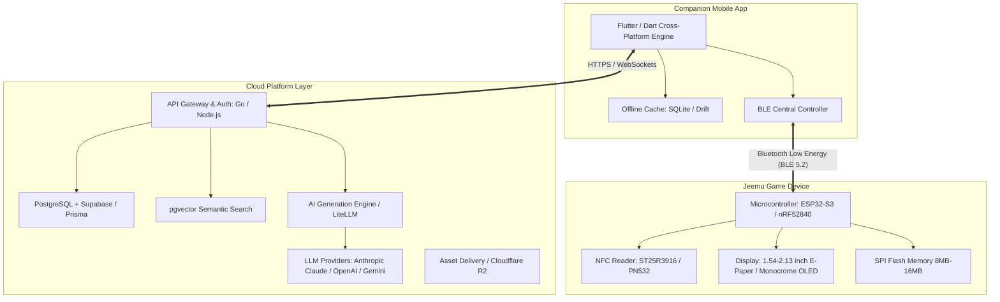
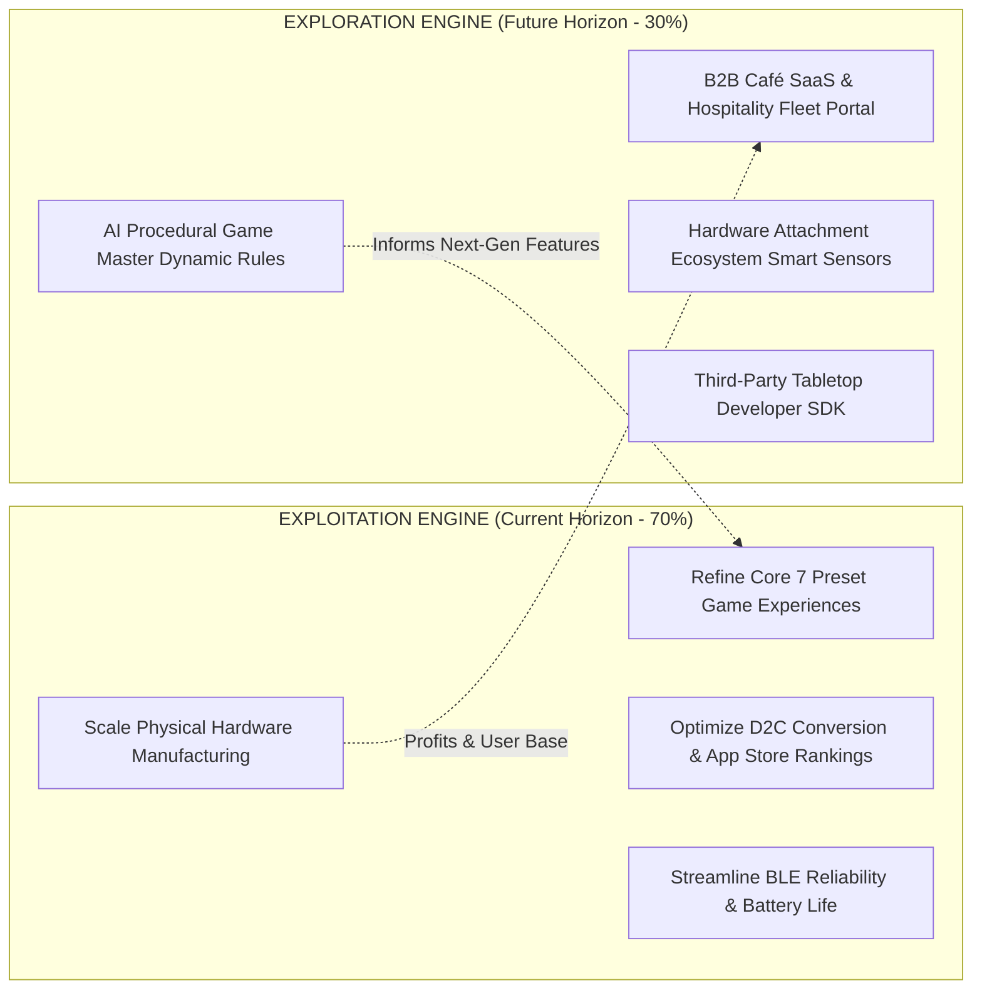
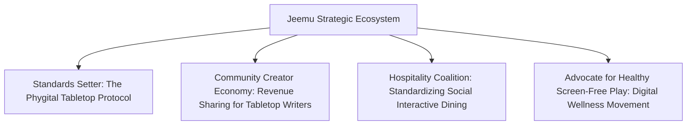

# Jeemu Technology Governance and Strategy Framework

## Executive Summary

Jeemu bridges physical tabletop play and digital adaptability by combining NFC-enabled wooden blocks, an intelligent standalone physical base unit, a companion mobile application, and an AI-driven UGC (User-Generated Content) marketplace. 

This framework establishes the operational governance, architectural standards, technology strategy, business alignment, and macro-environmental posture required to scale Jeemu sustainably from a boutique hardware-software product into an expansive "Phygital" platform.

---

## 1. Specific Tech & Applications

### 1.1 What We Automate
To operate with startup agility while maintaining consumer-grade reliability and low operational overhead, Jeemu implements automation across five core operational surfaces:

| Surface | Automated Processes | Tools & Pipeline | Impact & Objectives |
| :--- | :--- | :--- | :--- |
| **Firmware & Embedded** | Continuous build integration, automated unit testing of the state machine, Hardware-in-the-Loop (HIL) emulation for NFC reads & BLE handshakes, binary size tracking. | GitHub Actions, Renode / QEMU emulation, Nordic nRF Connect SDK / ESP-IDF CI tools. | Eliminates bricked devices, verifies memory constraints before flashing, maintains deterministic BLE transmission. |
| **Mobile Application** | Cross-platform build compilation, automated UI interaction flows (tap block simulation, sync configuration), snapshot regression testing, dynamic code signing. | Fastlane, GitHub Actions, Maestro / Flutter Driver. | Enables weekly zero-touch releases to Apple TestFlight and Google Play Internal tracks. |
| **AI Game Generation** | Evaluation harnesses testing prompt variations against latency, token cost, schema compliance, JSON validation, and safety guardrails. | Promptfoo, LangSmith / OpenLLMetry, Python eval scripts. | Prevents broken game formatting, hallucinated mechanics, and inappropriate prompt injections. |
| **Factory Provisioning** | Automated hardware flashing, cryptographic unique key generation (ED25519 / ECC), NFC block batch UID registration and verification. | Custom Python automated test fixtures over serial/JTAG, industrial NFC writers. | Guarantees authentic hardware validation, speeds assembly line throughput (<15s per unit), maps blocks to cryptographic IDs. |
| **Content Moderation** | Automated text screening for toxicity, hate speech, copyright infringement, and PII on marketplace submissions. | OpenAI Moderation API / Perspective API, automated regex filter layers. | Protects users across diverse categories (e.g. Kids vs. Drinking games) prior to human editorial review. |

---

### 1.2 Technology Stack Selection
Jeemu operates on a hybrid topology: **Zero-latency Edge Hardware**, **Client Companion App**, and **Cloud Service Layer**.



#### Detailed Architecture Rationale:
1. **Physical Device (Embedded)**:
   - **Microcontroller**: *Nordic nRF52840* or *ESP32-S3*. The nRF52840 offers best-in-class ultra-low power consumption and rock-solid BLE stack stability. The ESP32-S3 provides high compute for graphic rendering and native USB-OTG at a lower unit cost.
   - **NFC Transceiver**: *ST25R3916* or *NXP PN532*. High RF sensitivity ensures reliable coupling through wooden blocks even when players place them down quickly or slightly off-center.
   - **Display Technology**: *Sharp Memory LCD* or *Monochrome OLED / E-Paper*. High contrast under bar/party lighting and outdoor sunlight, minimal battery draw, wide viewing angles for group interaction.
   - **Embedded Firmware**: *Zephyr RTOS* or *FreeRTOS*. Enforces clean task separation (BLE stack, NFC polling, Display rendering, and State engine).

2. **Companion Client (Mobile)**:
   - **Framework**: *Flutter*. Cross-platform parity (iOS & Android) with unified 60fps rendering, custom design system flexibility, and proven native BLE plugins (`flutter_reactive_ble`).
   - **Local Storage**: *SQLite / Drift*. Complete offline-first architecture; users can edit and transfer previously downloaded or generated games in offline settings (cabins, parks, bars without Wi-Fi).

3. **Cloud & AI Layer**:
   - **Backend**: *FastAPI / Go*. Ultra-low latency, clean asynchronous request pipelines, and minimal memory footprint.
   - **Database & Search**: *PostgreSQL with pgvector* hosted on managed infrastructure (Supabase / AWS RDS). Handles game definitions, relational user profiles, and semantic embedding searches across the community marketplace.
   - **AI Orchestration**: Multi-provider fallback framework (Anthropic Claude 3.5 Sonnet / Haiku, GPT-4o-mini, Gemini Flash) with strict JSON Schema output enforcement to parse prompts directly into typed `GameConfig` structs.

---

### 1.3 Security & Maintenance Governance

1. **Hardware & Firmware Integrity**:
   - **Signed OTA Updates**: Firmware binaries are cryptographically signed using private ED25519 keys stored in offline HSMs. The bootloader validates signatures and supports dual-bank (A/B) memory partitioning to prevent device bricking during incomplete updates.
   - **BLE Security**: BLE pairings enforce LE Secure Connections (Numeric Comparison / Just Works with dynamic challenge handshakes). BLE configuration transfers require authenticated session keys exchanged via the companion app.
   - **NFC Tamper Mitigation**: Blocks use standard NTAG213/215 chips. Each block carries a factory-flashed cryptographic signature of its unique chip UID. Cloned tags missing valid cryptographic attestations can be flagged or quarantined.

2. **Data Privacy & Governance**:
   - **Screen-Free Physical Privacy**: The hardware unit has no camera, microphone, or persistent internet connection; it represents zero surveillance risk in private domestic environments.
   - **Child Safety Compliance (COPPA / GDPR-K)**: For the "Math Puzzles for Kids" and educational presets, strict zero-PII data collection is enforced. Children cannot access the marketplace without parent/guardian verification.
   - **User-Generated Content (UGC) Moderation**: Multi-tier pipeline combining automated semantic screening with community reporting and shadow-banning for malicious or unauthorized content.

3. **Maintenance Protocols**:
   - **Telemetry Without Intrusion**: Mobile app logs anonymous device error codes (BLE dropouts, CRC mismatches, NFC read failures) only when connected to Wi-Fi with user consent.
   - **Graceful Degradation**: If cloud services experience downtime, the physical device and local app continue operating without disruption via cached local configurations.

---

### 1.4 Infrastructure Fitness Assessment
- **Edge-First Efficiency**: By delegating all runtime game mechanics and display operations to the physical base unit, server operating costs remain virtually decoupled from user gameplay hours. 
- **Cost Scaling**: Infrastructure expenses scale with *game creation and marketplace discovery* rather than *hours of active play*. A player enjoying a 3-hour Jeemu party game incurs **$0.00** in cloud computing costs during gameplay.
- **Serverless & Managed Economics**: Backend services run on auto-scaling serverless containers (Cloud Run / AWS ECS Fargate) paired with serverless PostgreSQL. The baseline idle infrastructure costs under $50/month during early stage, scaling elastically during peak evening/weekend social hours.

---

### 1.5 Tech Stack Vulnerability Matrix

| Vulnerability Vector | Threat Scenario | Likelihood | Impact | Mitigation Strategy |
| :--- | :--- | :--- | :--- | :--- |
| **NFC Replay / Cloning** | Malicious users clone standard NFC tags to bypass paid block expansions or counterfeit custom sets. | Medium | Low-Med | Blocks utilize factory UID signing; firmware verifies cryptographic hash combinations stored in encrypted game configurations. |
| **BLE Interception / Hijacking** | Eavesdropping or hostile configuration overwrites during BLE transmission in public spaces (e.g. crowded bars). | Low | Medium | Session-based AES-GCM encryption for payload transfers; device only enters BLE advertising mode on explicit physical button presses. |
| **LLM Prompt Injection / Jailbreaks** | Malicious game creation prompts producing illicit content or bypassing category safety rules (e.g. generating predatory content in kids modes). | Medium | High | Two-stage LLM pipeline: Input prompt sanitization -> Generation -> Guardrail validation pass. Automated hard stop filters on sensitive keywords. |
| **Silicon & Component Obsolescence** | Supply chain shocks rendering chosen microcontrollers or NFC driver chips unavailable. | Medium | High | Hardware Abstraction Layer (HAL) built into the firmware codebase; dual-footprint PCB routing allowing alternate MCU/NFC footprint assembly. |
| **UGC Script Injection / DoS** | Marketplace game configurations attempting to exploit firmware buffer boundaries with oversized strings or format string exploits. | Low | High | Strict JSON schema parsing with enforced character limits (e.g., maximum 96 characters per block prompt); zero dynamic code execution on the embedded device. |

---

## 2. Technology Strategy

### 2.1 The Core Business Problem to Solve
Physical board games foster genuine human connection, tactical friction, and physical tension, but suffer from **rigid content stagnation** (once a game deck is played, novelty degrades). 

Conversely, digital party games offer infinite variety but demand **relentless screen engagement**, fracturing eye contact and diminishing social cohesion.

```
Traditional Tabletop              Digital Social Games                    Jeemu Hybrid Solution
┌──────────────────────┐         ┌──────────────────────┐         ┌─────────────────────────────────┐
│ High tactile tension │         │ Infinite variations  │         │ Tactical physical Jenga tension │
│ Real eye contact     │         │ Dynamic updates      │         │ 100% Screen-free during play    │
│ Stagnant, fixed deck │         │ Screen distraction   │         │ Infinite AI/UGC game modes      │
└──────────────────────┘         └──────────────────────┘         └─────────────────────────────────┘
```

**Technology's Strategic Imperative**: Deliver dynamic digital reconfigurability without introducing screens into the magic circle of live tabletop gameplay.

---

### 2.2 Buy, Build, or Partner Matrix

```mermaid
quadrantChart
    title Buy vs Build vs Partner Strategic Quadrant
    x-axis Low Differentiation --> High Strategic Differentiation
    y-axis Low Operational Execution Difficulty --> High Operational Execution Difficulty
    quadrant-1 Build Core (In-House Mastery)
    quadrant-2 Partner / License (Co-Development)
    quadrant-3 Buy Off-the-Shelf (Commodity)
    quadrant-4 Rapid Internal Assembly
    "Custom BLE Hardware Sync Protocol": [0.85, 0.45]
    "NFC State & Block Mapping Engine": [0.92, 0.50]
    "AI Game Creation Prompt Pipeline": [0.78, 0.35]
    "Companion Mobile App UX": [0.80, 0.40]
    "Commercial Board Game IP": [0.88, 0.85]
    "Contract Manufacturing & SMT Assembly": [0.35, 0.90]
    "Café POS Integration Middleware": [0.55, 0.75]
    "Cloud Hosting & Managed Postgres": [0.15, 0.20]
    "Auth / User Identity (Supabase/Auth0)": [0.10, 0.15]
    "Foundation LLM Models (Claude/OpenAI)": [0.30, 0.88]
    "Payment Gateway (Stripe/App Stores)": [0.12, 0.25]
```

#### Detailed Breakdown:

1. **BUILD (Core Strategic IP - Retain In-House)**:
   - **Hardware-Firmware Interaction Stack**: NFC reading heuristics, debounce algorithms, multi-tap rejection, battery conservation protocols.
   - **Configuration Sync Protocol**: Compressed binary wire format transferring complete 45-block game configurations over BLE in <1.2 seconds.
   - **AI Game Generator**: Proprietary prompt framing and JSON structuring pipelines that understand social balance, comedic timing, and game mechanics.
   - **Mobile Content Management Architecture**: The user experience of customizing, saving, and managing games.

2. **BUY (Commodity Infrastructure - Maximize Speed & Reliability)**:
   - **Cloud Infrastructure & Managed Storage**: Supabase, AWS, Cloudflare CDN.
   - **Authentication & Payments**: Supabase Auth / Clerk; Apple StoreKit / Google Play Billing / Stripe.
   - **Foundation Models**: Anthropic Claude, OpenAI, and Google Gemini via standardized API abstraction layers.

3. **PARTNER (Strategic Leverage - Accelerate Ecosystem Expansion)**:
   - **Contract Manufacturing & SMT**: High-tier EMS (Electronics Manufacturing Services) partners for automated PCB assembly and precision timber block milling.
   - **Branded IP Holders & Publishers**: Partnerships with board game designers and entertainment franchises (e.g. licensed trivia, themed franchise editions).
   - **Hospitality & Retail Distributors**: Distributors specializing in café, brewery, and entertainment hospitality equipment.

---

### 2.3 Interoperability & Architectural Cohesion
The building blocks integrate through strictly defined, versioned interfaces:

```
[Cloud Marketplace & AI Engine] 
            │ (OpenAPI / HTTPS REST + WebSockets)
            ▼
[Mobile App: Engine & Local Cache]
            │ (Compressed Binary Protocol over BLE GATT)
            ▼
[Physical Jeemu Device: State Machine]
            │ (13.56 MHz ISO/IEC 14443 Type A NFC)
            ▼
[NFC Passive Identity Tags in Blocks]
```

- **Loose Coupling**: The mobile app functions autonomously if the cloud is unreachable. The physical device functions autonomously once loaded with configuration.
- **Backwards & Forwards Compatibility**: Hardware firmware exposes standard BLE GATT services with contract versioning. Newer mobile app releases can communicate with older firmware revisions through structured protocol handshakes.

---

### 2.4 Avoiding Vendor Lock-in & Maintaining Architectural Flexibility
To protect Jeemu against technology deprecation, pricing shocks, and platform rent-seeking:

1. **Model-Agnostic AI Pipeline**:
   - The AI generation engine communicates via an abstract LLM gateway (e.g., LiteLLM / custom provider interface).
   - If pricing, terms, or availability shift between Anthropic, OpenAI, or Google, traffic redirects with zero client-side updates.
   - Preparedness for local/open-weight model execution (e.g., Llama 3 / Mistral) if offline edge generation is introduced.

2. **Silicon Multi-Sourcing**:
   - Firmware is written against standard POSIX / RTOS abstractions (Zephyr RTOS), decoupling business logic from proprietary silicon vendor libraries.
   - PCB schematics anticipate pin-compatible alternative microcontrollers.

3. **Data Portability**:
   - Game configurations use an open, human-readable JSON schema (`Jeemu Game Specification v1`).
   - Community creators can export, backup, and share configurations as raw files outside the proprietary marketplace.

---

## 3. Business Strategy Alignment

### 3.1 Realizing Business Strategy Through Technology
Jeemu transforms a traditional consumer goods toy model into a high-margin, sticky ecosystem:

```
Traditional Hardware Model               Jeemu Phygital Ecosystem Model
┌────────────────────────────┐          ┌────────────────────────────────────────────────────┐
│ One-time purchase          │          │ Initial Hardware Purchase (Entry point)            │
│ Flat revenue per unit      │   ───►   │ Continuous Digital Content Subscriptions           │
│ Low margin (~15-25%)       │          │ AI-Assisted Creator Royalties & Marketplace Fees   │
│ Zero post-purchase insight │          │ B2B Commercial Café Licensing & Custom Promotions  │
└────────────────────────────┘          └────────────────────────────────────────────────────┘
```

1. **Zero-Marginal-Cost Product Expansion**: A player who purchases the 45-block base set can experience 500+ distinct games without purchasing additional physical plastic or timber.
2. **AI as an Adoption Accelerator**: Generating a customized, themed game for a friend's birthday, a corporate workshop, or a specific drinking gathering takes under 30 seconds, removing the friction of manual configuration.
3. **Network Effects in the UGC Marketplace**: Popular community creators and brands publish game packs. As more creators contribute, the utility of owning the physical Jeemu box compounds.

---

### 3.2 Pursuing Organizational Ambidexterity
To avoid the classic trap of over-focusing on current operations at the expense of disruptive innovation (or vice versa), Jeemu structures its technological and strategic initiatives along a dual-track ambidextrous framework:



| Dimension | Exploitation Track (Core Business) | Exploration Track (New Horizons) |
| :--- | :--- | :--- |
| **Strategic Goal** | Scale consumer hardware sales; maximize user retention across the initial 7 categories. | Discover high-margin recurring SaaS streams; redefine interactive social spaces. |
| **Primary Audience** | Individual consumers, game night hosts, families, party groups. | Hospitality venue owners, corporate facilitators, third-party tabletop game designers. |
| **Tech Focus** | Flawless BLE pairing, <200ms NFC latency, factory yield optimization, battery longevity. | Multi-unit fleet telemetry, dynamic QR table ordering integrations, procedural AI narration engines, hardware expansion bus APIs. |
| **Success Metrics** | Units shipped, CAC / LTV, Day-30 app engagement, Net Promoter Score (NPS). | B2B recurring subscription MRR, marketplace creator payouts, API integration volume. |
| **Governance Mode** | Rigorous QA, cost optimization, structured release cycles. | Rapid agile experimentation, lightweight pilot programs, prototype sandboxes. |

---

## 4. External Environment (PESTEL & Strategic Influence)

### 4.1 PESTEL Macro-Environmental Analysis

```
                    ┌─────────────────────────────────────────────────────────┐
                    │               EXTERNAL MACRO-FORCES (PESTEL)            │
                    └─────────────────────────────────────────────────────────┘
                                                 │
         ┌───────────────────┬───────────────────┼───────────────────┬───────────────────┐
         ▼                   ▼                   ▼                   ▼                   ▼
    POLITICAL           ECONOMIC            SOCIAL             TECHNOLOGICAL       ENVIRONMENTAL
 • Tariffs on        • Discretionary     • Screen fatigue     • Maturation of     • E-waste laws
   electronics         spending cycles     & digital detox      LLMs at the edge    (WEEE / RoHS)
 • Cross-border      • Component BOM     • Resurgence of      • Falling NFC tag   • Sustainable FSC
   data rules          inflation risks     tabletop gaming      silicon costs       wood sourcing
```

#### Detailed Dimension Assessment:

1. **Political**:
   - *Hardware Supply Chain*: Cross-border tariffs on assembled electronics (notably between Asia, North America, and Europe) necessitate a multi-country assembly contingency plan (e.g. Vietnam / Mexico / India options).
   - *Data Sovereignty*: Storing user-generated configurations across EU/US mandates regional data isolation and GDPR-compliant cloud tenancies.

2. **Economic**:
   - *Inflation & Disposable Income*: When consumer discretionary spending tightens, high-priced physical toys suffer. Jeemu counters this by offering the value proposition of *one purchase replacing dozens of traditional party games*.
   - *BOM Volatility*: Silicon price spikes can erode hardware margins. Jeemu's software freemium marketplace acts as a margin buffer.

3. **Sociocultural**:
   - *The Screen Detox Movement*: Consumers are actively seeking entertainment that brings people face-to-face without smartphones dominating the table. Jeemu directly champions this cultural counter-trend by intentionally eliminating screens during gameplay.
   - *Personalization Culture*: Modern audiences expect entertainment customized to their private inside jokes, specific social circles, or themed events.

4. **Technological**:
   - *Rapid Generative AI Evolution*: Declining inference costs enable sophisticated procedural game generation on demand.
   - *NFC & Low-Power RF Innovations*: High-tolerance, flexible NFC antennas enable ultra-reliable reads within non-conductive timber and acrylic enclosures.

5. **Environmental**:
   - *Sustainability Mandate*: Single-use plastic toys face increasing consumer and regulatory backlash. Jeemu commits to FSC-certified sustainable timber blocks, non-toxic finishes, recyclable packaging, and easily repairable/replaceable hardware assemblies.
   - *Circular Battery Lifecycle*: Deploying accessible, standard rechargeable lithium-ion cells rather than glued-in batteries extends product life and complies with EU Right-to-Repair directives.

6. **Legal & Regulatory**:
   - *Game Mechanics & Trademark Governance*: The mechanics of removing and stacking blocks are public domain, but the "Jenga" brand is a registered trademark of Hasbro/Pokonobe Associates. Jeemu strictly maintains its own distinct branding, industrial design, and marketing identity ("Jeemu - The Smart Customizable Tabletop System").
   - *Product Safety Regulations*: Physical wooden and electronic components must comply with ASTM F963 (US), EN 71 (EU), and FCC/CE radio certifications.
   - *Copyright in the Marketplace*: Automated IP screening prevents community users from uploading copyrighted trivia or licensed IP into public marketplace tiers.

---

### 4.2 Reshaping Our Business Model Using Emerging Technologies
As underlying technologies advance, Jeemu can strategically transform its operating model:

1. **Dynamic Procedural Game Masters**: Leveraging low-latency LLMs to evolve from static pre-configured block assignments to *dynamically evolving storylines*. If a player pulls a specific high-difficulty block, subsequent block prompts can procedurally adapt to prior gameplay choices in real time.
2. **Physical Modular Hardware Expansions**: Utilizing the hardware attachment port to connect specialized peripherals (e.g., electronic timers, audio synthesizers, capacitive vibration sensors, party lighting peripherals), turning the base unit into a multi-game console for physical tabletop gaming.
3. **Phygital Web3 / Verified Ownership (Optional Horizon)**: Using verifiable digital credentials for limited-edition physical tournament blocks or creator-signed master sets.

---

### 4.3 Influencing and Shaping Our Environment
Rather than merely reacting to market conditions, Jeemu proactively shapes its ecosystem:



1. **Standardizing the Phygital Tabletop Protocol**: By establishing and championing open data standards for NFC-to-digital game interactions, Jeemu can invite indie board game publishers to build on its hardware foundation.
2. **Empowering the Creator Economy for Game Designers**: Providing monetization for tabletop game writers and comedians who lack the capital to manufacture physical board games, establishing Jeemu as the "Steam / Substack of Tabletop Play."
3. **Pioneering Digital Wellness & Social Connection**: Actively partnering with universities, social wellness organizations, and cafes to promote validated screen-free social bonding solutions.

---

## 5. Governance Action Plan & Review Cadence

| Cadence | Review Forum | Focus Areas & Mandates | Accountable Owners |
| :--- | :--- | :--- | :--- |
| **Bi-Weekly** | **Firmware & Security Sync** | Review BLE security logs, OTA pipeline health, binary size limits, and dependency CVE vulnerability reports. | Lead Firmware Engineer, Security Lead |
| **Monthly** | **AI & Content Governance** | Evaluate prompt evaluation metrics, token cost curves, false positive rates in moderation, and marketplace UGC copyright reports. | AI/ML Lead, Community Operations |
| **Quarterly** | **Strategic Ambidexterity Audit** | Audit the 70/30 resource allocation between Core Exploitation (hardware yield, core app) and Exploration (B2B café pilots, SDK development). | Founders, Head of Product |
| **Annual** | **PESTEL Macro-Environmental Refresh** | Update regulatory compliance plans (safety, battery, privacy), review silicon supply contracts, audit environmental footprint and packaging sustainability. | Executive Leadership, Legal Counsel |
